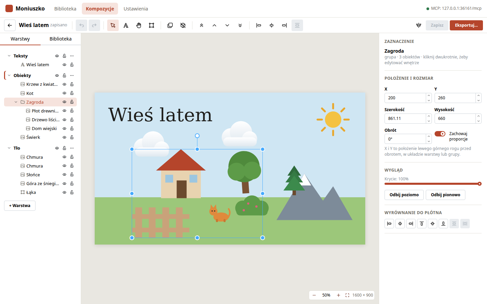
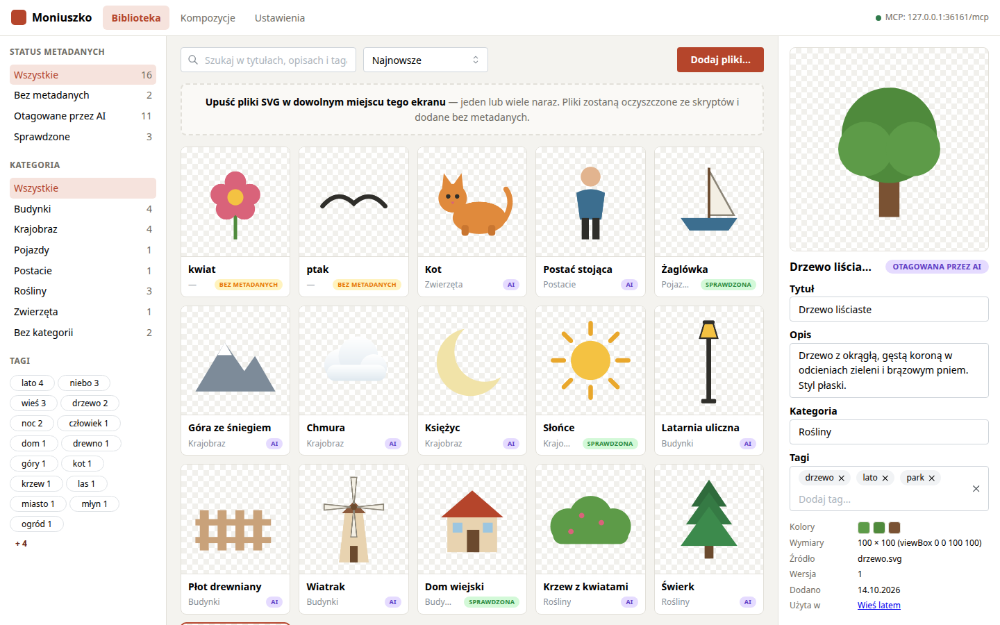
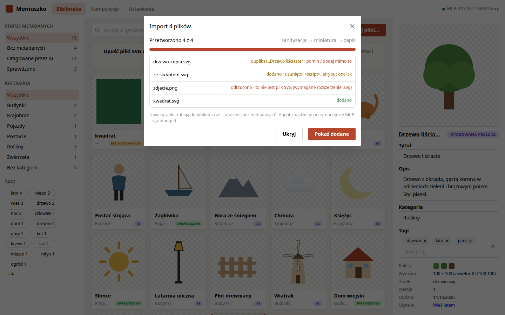
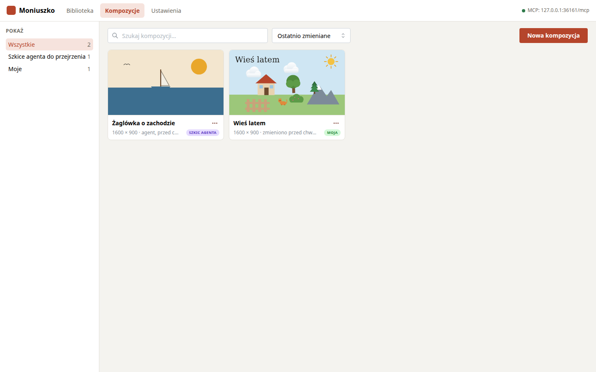
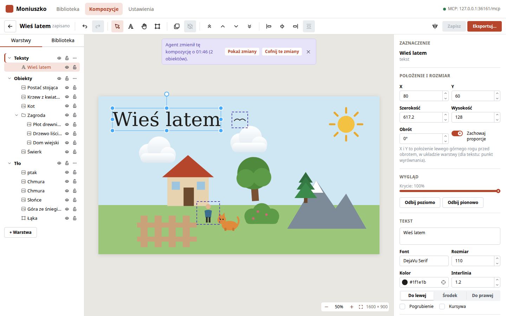

# Moniuszko

Biblioteka grafik SVG z metadanymi i edytor kompozycji, czyli pojedynczych plików SVG
złożonych z grafik z biblioteki, tekstów i prostych kształtów. Agent AI (np. Claude Code)
przegląda i opisuje bibliotekę oraz składa kompozycje przez MCP. Człowiek poprawia je w
edytorze.



## Dokumentacja

| Dokument | Zawartość |
|---|---|
| [docs/LIBRARY.md](docs/LIBRARY.md) | dodawanie grafik, metadane, wyszukiwanie |
| [docs/EDITOR.md](docs/EDITOR.md) | praca w edytorze, skróty klawiszowe, eksport |
| [docs/MCP.md](docs/MCP.md) | podłączenie agenta, narzędzia, przykładowe polecenia |
| [docs/DEVELOPMENT.md](docs/DEVELOPMENT.md) | uruchomienie do rozwoju, architektura, testy, migracje |
| [docs/PLAN.md](docs/PLAN.md) | plan i decyzje projektowe |
| [docs/mockups/](docs/mockups/index.html) | pierwotne makiety ekranów |
| [TODO.md](TODO.md) | rzeczy odłożone |

## Szybki start

Wymagania: Node 22 i npm 10.

```bash
npm install
npm run build
npm start
```

Aplikacja jest pod <http://localhost:4400>. Przy pierwszym uruchomieniu powstaje plik
`moniuszko.config.json` i folder `workspace/` z bazą, grafikami i kompozycjami. Folder i port
zmienia się w tym pliku albo na ekranie Ustawienia.

Podłączenie Claude Code do serwera MCP:

```bash
claude mcp add --transport http moniuszko http://localhost:4400/mcp
```

## Ekrany

**Biblioteka.** Grafiki dodaje się przez upuszczenie plików SVG na ekran albo przyciskiem
„Dodaj pliki…”. Panel po prawej pokazuje i zmienia metadane zaznaczonej grafiki. Filtry po
lewej zawężają listę według statusu metadanych, kategorii i tagów.



**Import.** Każdy plik jest oczyszczany ze skryptów i odwołań zewnętrznych. Okno importu
pokazuje, co usunięto, które pliki są duplikatami i które zostały odrzucone.



**Kompozycje.** Lista kompozycji z miniaturami. Szkice utworzone przez agenta są oznaczone
i mają osobny filtr.



**Edytor.** Warstwy i panel biblioteki po lewej, płótno pośrodku, inspektor po prawej. Gdy
agent zmieni otwartą kompozycję, edytor wczytuje zmianę, pokazuje, co się zmieniło, i
pozwala ją cofnąć.



**Podgląd dla agenta.** Narzędzia MCP zwracają render PNG kompozycji, żeby agent mógł
sprawdzić swój układ.


