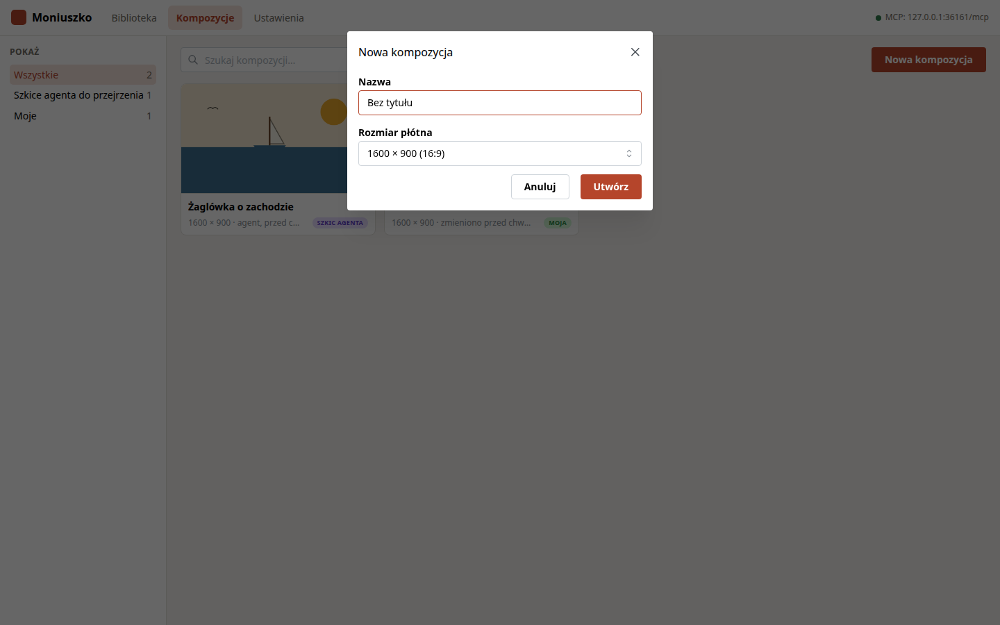
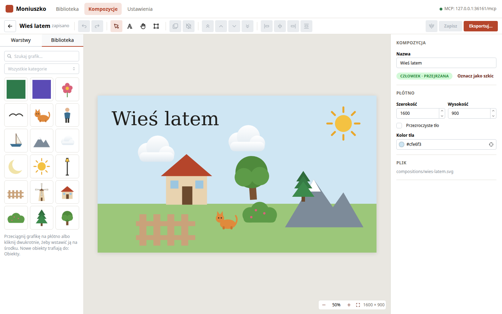
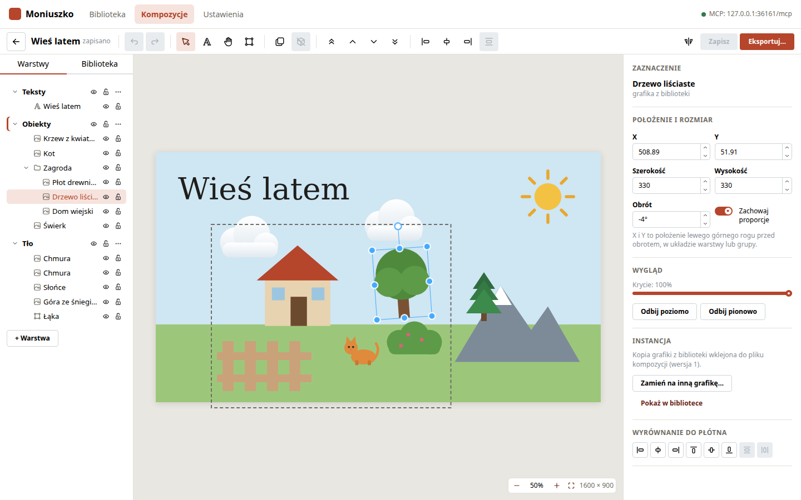
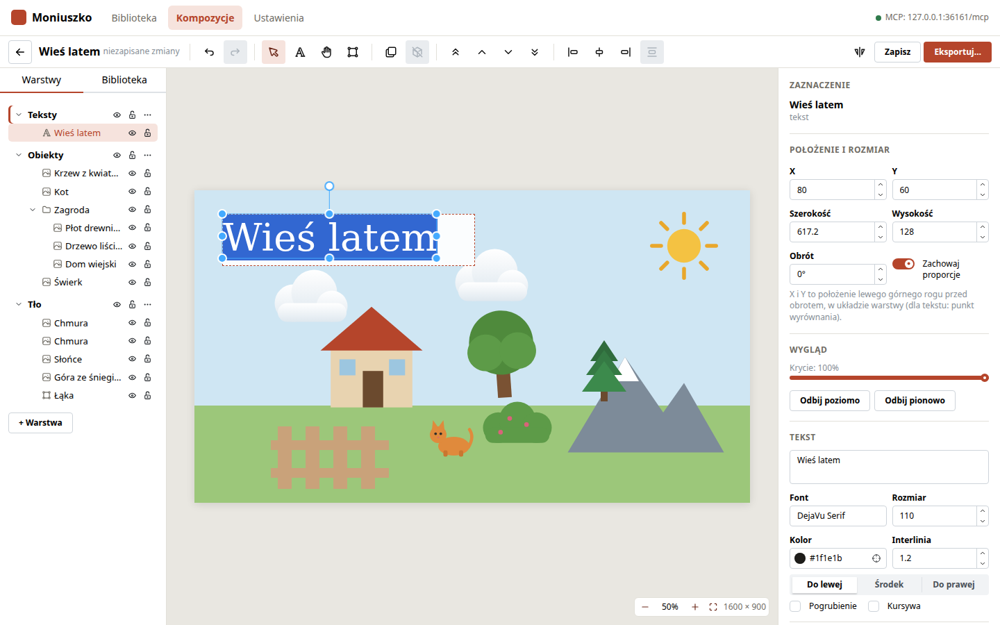
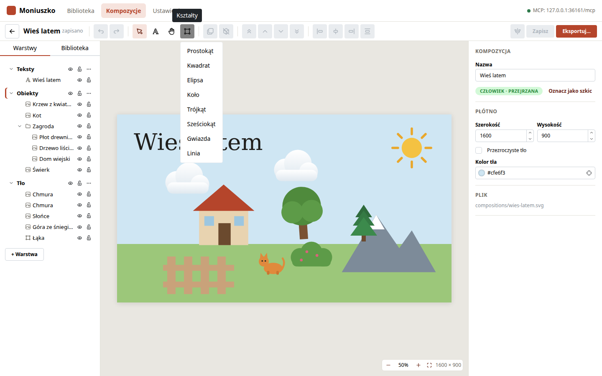
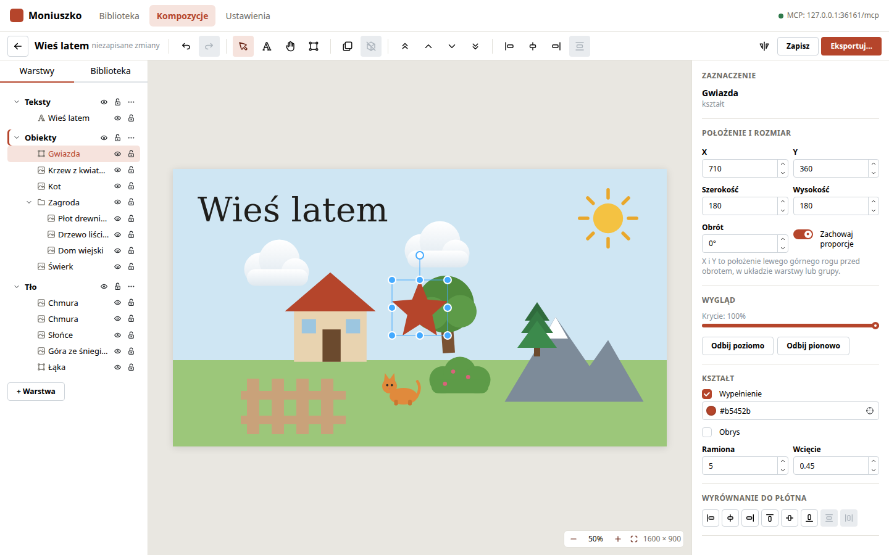
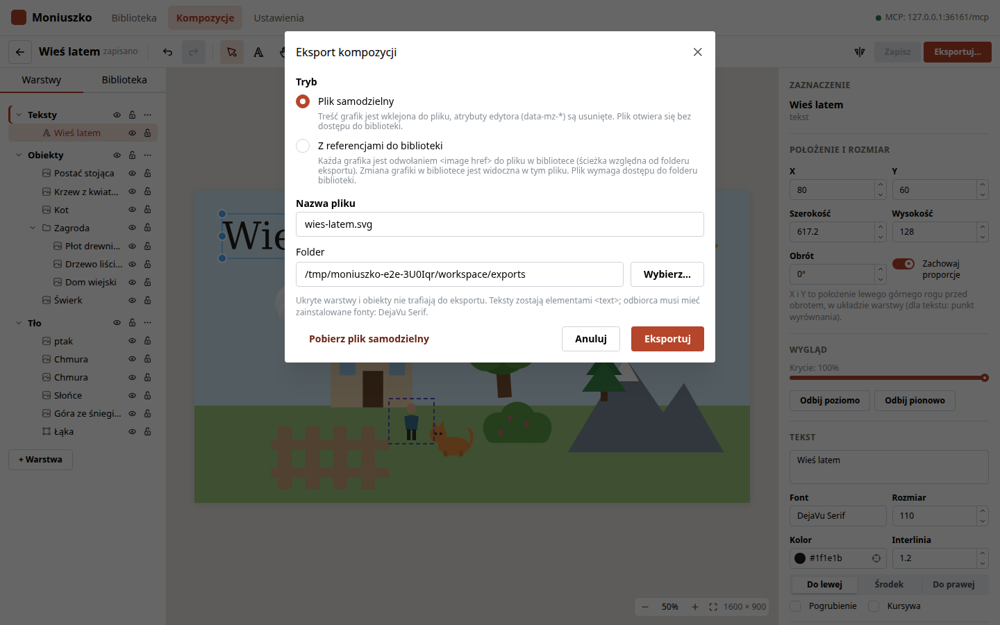

# Edytor kompozycji

Kompozycja to jeden plik SVG złożony z grafik z biblioteki, tekstów i kształtów,
rozłożonych na warstwy.

## Lista kompozycji

Ekran Kompozycje pokazuje wszystkie pliki z folderu kompozycji. Filtr „Szkice agenta do
przejrzenia” zostawia kompozycje utworzone przez agenta, których nikt jeszcze nie oznaczył
jako przejrzanych. Menu „…” na karcie: otwórz, zmień nazwę, duplikuj, pobierz SVG, usuń.

„Nowa kompozycja” pyta o nazwę i rozmiar płótna. Nowa kompozycja ma trzy warstwy: Tło,
Obiekty i Teksty.

## Układ edytora

- **Lewy panel, zakładka Warstwy:** warstwy od wierzchu do spodu, a w nich obiekty. Kliknięcie
  warstwy czyni ją aktywną (do niej trafiają nowe obiekty; aktywną warstwę zaznacza pasek
  z lewej). Ikony oka i kłódki ukrywają i blokują warstwę lub obiekt. Dwuklik zmienia nazwę.
  Menu „…” warstwy: zmiana kolejności, przeniesienie zaznaczonych obiektów, usunięcie.
- **Lewy panel, zakładka Biblioteka:** wyszukiwanie grafik. Grafikę przeciąga się na płótno
  albo wstawia na środek dwuklikiem.
- **Płótno:** zaznaczanie, przesuwanie, obrót i skalowanie.
- **Inspektor:** położenie, rozmiar, obrót, krycie i właściwości zaznaczonego obiektu. Bez
  zaznaczenia: nazwa kompozycji, status, rozmiar i tło płótna.

## Praca na płótnie

| Czynność | Jak |
|---|---|
| Zaznaczenie | kliknięcie obiektu; Shift+klik dodaje do zaznaczenia; przeciągnięcie po pustym miejscu zaznacza prostokątem |
| Przesunięcie | przeciągnięcie; z Shift tylko w poziomie albo w pionie; strzałki o 1 px, Shift+strzałki o 10 px |
| Obrót | uchwyt nad zaznaczeniem; z Shift co 15° |
| Skalowanie | uchwyty narożne i boczne; proporcje zależą od przełącznika „Zachowaj proporcje” w inspektorze |
| Wnętrze grupy | dwuklik na grupie zaznacza obiekt w środku; Esc wraca poziom wyżej |
| Edycja tekstu | dwuklik na tekście; Ctrl+Enter albo kliknięcie obok zatwierdza, Esc anuluje |
| Zoom | Ctrl+kółko myszy, przyciski w prawym dolnym rogu, „Dopasuj do okna” |
| Przewijanie widoku | narzędzie rączki (H), trzymana spacja albo środkowy przycisk myszy |

## Teksty i kształty

Narzędzie Tekst (T) i kliknięcie na płótnie dodaje tekst w aktywnej warstwie. W inspektorze
zmienia się treść, font, rozmiar, kolor, interlinię, wyrównanie, pogrubienie i kursywę.

Menu Kształty wstawia prostokąt, kwadrat, elipsę, koło, trójkąt, sześciokąt, gwiazdę albo
linię. Inspektor zmienia wypełnienie, obrys, zaokrąglenie narożników prostokąta, liczbę
boków wielokąta oraz liczbę ramion i wcięcie gwiazdy.

## Skróty klawiszowe

| Skrót | Polecenie |
|---|---|
| Ctrl+Z / Ctrl+Shift+Z | cofnij / ponów |
| Ctrl+S | zapisz od razu |
| V / T / H | zaznaczanie / tekst / przesuwanie widoku |
| Ctrl+G / Ctrl+Shift+G | grupuj / rozgrupuj |
| Ctrl+D | duplikuj |
| Ctrl+C / Ctrl+V | kopiuj / wklej (do aktywnej warstwy) |
| Ctrl+A | zaznacz wszystko na bieżącym poziomie |
| Delete | usuń |
| Ctrl+] / Ctrl+[ | wyżej / niżej |
| Ctrl+Shift+] / Ctrl+Shift+[ | na wierzch / na spód |
| Esc | wyjście z grupy, powrót do zaznaczania, odznaczenie |

## Zapis

Edytor zapisuje plik 1,5 s po ostatniej zmianie; Ctrl+S zapisuje od razu. Stan zapisu jest
obok nazwy na pasku narzędzi.

Gdy agent albo inna karta przeglądarki zapisze tę samą kompozycję:

- bez niezapisanych zmian w edytorze: edytor wczytuje nową wersję i pokazuje komunikat.
  „Pokaż zmiany” obrysowuje zmienione obiekty, „Cofnij te zmiany” przywraca poprzednią
  wersję (to zwykły krok historii, więc Ctrl+Z działa tak samo).
- z niezapisanymi zmianami: komunikat pozwala wczytać wersję z serwera albo zapisać własną
  w jej miejsce.

## Eksport

„Eksportuj…” zapisuje kompozycję do wskazanego folderu w jednym z dwóch trybów:

| Tryb | Wynik |
|---|---|
| Plik samodzielny | treść grafik jest wklejona do pliku; plik nie zależy od biblioteki |
| Z referencjami do biblioteki | każda grafika to `<image href>` ze ścieżką względną do pliku w bibliotece; zmiana grafiki w bibliotece jest widoczna w pliku |

W obu trybach ukryte warstwy i obiekty są pomijane, a atrybuty edytora usuwane. Teksty
zostają elementami `<text>`, więc odbiorca potrzebuje użytych fontów (okno eksportu je
wymienia). „Pobierz plik samodzielny” pobiera plik przez przeglądarkę.

## Plik kompozycji

Plik roboczy (`compositions/<id>.svg`) otwiera się w przeglądarce i w Inkscape. Edytor
odtwarza z niego scenę na podstawie atrybutów `data-mz-*`; format opisuje
[PLAN.md](PLAN.md#kompozycja). Plik niezgodny z formatem jest wymieniony na ekranie
Kompozycje z opisem błędu.
