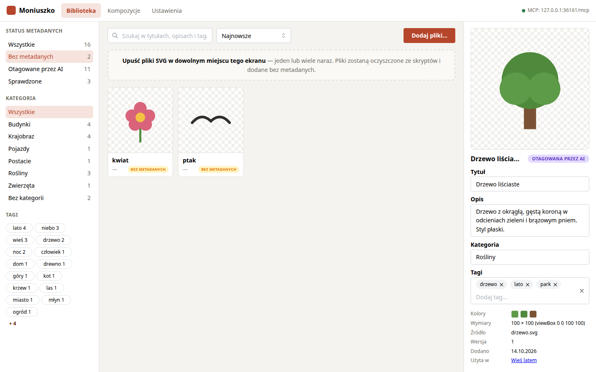

# Biblioteka grafik

Biblioteka przechowuje grafiki SVG i ich metadane: tytuł, opis, kategorię i tagi. Na ich
podstawie agent i człowiek wyszukują grafiki do kompozycji.


## Dodawanie grafik

Są trzy sposoby:

1. **Upuszczenie plików** w dowolnym miejscu ekranu Biblioteka. Można upuścić jeden plik lub
   wiele naraz.
2. **Przycisk „Dodaj pliki…”** otwiera systemowe okno wyboru plików (wiele naraz).
3. **Agent przez MCP**, narzędziem `add_graphic`, z treścią SVG i opcjonalnie od razu z
   metadanymi (zob. [MCP.md](MCP.md)).

Każdy plik przechodzi przez te same kroki:

| Krok | Co się dzieje |
|---|---|
| Sprawdzenie | Plik musi mieć rozszerzenie `.svg`, być poprawnym XML i mieć element główny `<svg>` z wymiarami (`viewBox` albo `width`/`height` w px). W przeciwnym razie zostaje odrzucony. |
| Duplikaty | Plik o identycznej treści co istniejąca grafika nie jest dodawany. W oknie importu można go pominąć albo dodać mimo to. Ostrzeganie wyłącza się w Ustawieniach. |
| Sanityzacja | Usuwane są `<script>`, atrybuty `on*`, `<foreignObject>`, elementy edytorów (Inkscape, Sodipodi) oraz odwołania do plików i adresów spoza grafiki. Okno importu wymienia, co usunięto. |
| Normalizacja | Opcjonalnie svgo (`preset-default`), włączana w Ustawieniach. `viewBox` zostaje zachowany. |
| Zapis | Oczyszczony plik trafia do `library/<id>.svg`, oryginał do `library/originals/<id>.svg`, a miniatura PNG do `thumbnails/graphics/`. |


Nowa grafika dostaje tytuł z nazwy pliku i status **bez metadanych**.

## Metadane

| Pole | Opis |
|---|---|
| Tytuł | krótka nazwa, np. „Drzewo liściaste” |
| Opis | jedno lub dwa zdania o tym, co przedstawia grafika, w jakim stylu i kolorach |
| Kategoria | jedna kategoria, np. Rośliny, Budynki, Krajobraz; lista podpowiada istniejące |
| Tagi | dowolne słowa; zapisywane małymi literami, bez powtórzeń |
| Kolory | dominujące kolory, liczone przy imporcie (tylko do odczytu) |

Status metadanych:

| Status | Znaczenie |
|---|---|
| bez metadanych | grafika po imporcie |
| otagowana przez AI | metadane zapisał agent (`update_graphic_metadata`) |
| sprawdzona | człowiek kliknął „Oznacz jako sprawdzoną” |

Zmiana pól w panelu i „Zapisz” nie zmienia statusu. Status zmienia przycisk „Oznacz jako
sprawdzoną”.



Opisywanie wielu grafik najlepiej zlecić agentowi: filtr „Bez metadanych” pokazuje, co
zostało do zrobienia, a agent dostaje te same grafiki narzędziem `list_untagged` (zob.
[MCP.md](MCP.md#tagowanie-biblioteki)).

## Wyszukiwanie

Pole wyszukiwania przeszukuje tytuł, opis, tagi i kategorię. Każde słowo musi wystąpić,
ostatnie może być początkiem słowa („drze” znajduje „drzewo”). Polskie znaki są pomijane
(„zolty” znajduje „żółty”). Filtry statusu, kategorii i tagów łączą się z wyszukiwaniem.

## Inne operacje

- **Zastąp plik…** podmienia treść grafiki z zachowaniem metadanych i podnosi jej wersję.
  Kompozycje, które jej używają, mają kopię starej wersji. W edytorze pojawia się wtedy
  przycisk „Podmień na aktualną wersję”.
- **Pokaż oryginał** wyświetla plik w postaci sprzed sanityzacji.
- **Pobierz SVG** pobiera oczyszczony plik.
- **Usuń** usuwa grafikę z biblioteki. Kompozycje zachowują swoje kopie, ale eksport z
  referencjami ich nie obejmie.
- Pole „Użyta w” wymienia kompozycje, które zawierają grafikę.

## Pliki na dysku

```
<workspace>/
  moniuszko.db                 metadane i indeks wyszukiwania
  library/<id>.svg             grafiki po sanityzacji
  library/originals/<id>.svg   pliki w postaci z importu
  thumbnails/graphics/<id>.png miniatury
```

Metadane są tylko w bazie. Pliki SVG dodane do `library/` z pominięciem aplikacji nie
pojawią się w bibliotece; serwer wypisuje je przy starcie jako ostrzeżenie.
