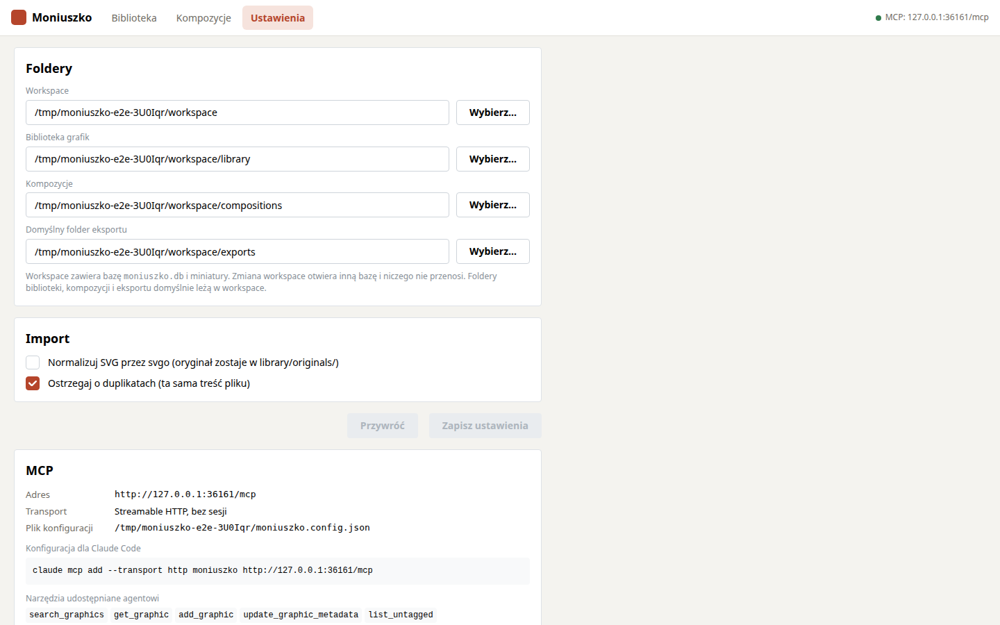

# Agent i MCP

Serwer MCP jest częścią serwera aplikacji i działa pod `/mcp` (transport Streamable HTTP,
bez sesji). Agent ma dostęp do tej samej biblioteki i tych samych kompozycji co edytor.

## Podłączenie

Claude Code, serwer aplikacji uruchomiony przez `npm start`:

```bash
claude mcp add --transport http moniuszko http://localhost:4400/mcp
```

W trybie deweloperskim (`npm run dev`) serwer też nasłuchuje na porcie 4400; adres
`http://localhost:5173/mcp` przechodzi przez proxy Vite i działa tak samo.

Po dodaniu serwera `claude mcp list` powinien pokazać `moniuszko` jako połączony. Adres i
polecenie są też na ekranie Ustawienia.



## Narzędzia

**Biblioteka**

| Narzędzie | Działanie |
|---|---|
| `search_graphics` | wyszukiwanie po tekście, statusie, kategorii i tagach; lista bez podglądów |
| `get_graphic` | metadane, lista kompozycji, w których grafika jest użyta, podgląd PNG, opcjonalnie treść SVG |
| `add_graphic` | dodanie grafiki z treści SVG, opcjonalnie z metadanymi |
| `update_graphic_metadata` | tytuł, opis, kategoria, tagi (`tags` zastępuje listę, `addTags`/`removeTags` ją zmieniają); ustawia status „otagowana przez AI” |
| `list_untagged` | grafiki bez metadanych z podglądami PNG |
| `get_library_overview` | liczby według statusu, istniejące kategorie i najczęstsze tagi |

**Kompozycje**

| Narzędzie | Działanie |
|---|---|
| `list_compositions` | lista kompozycji (i pliki, których nie udało się odczytać) |
| `get_composition` | struktura: płótno, warstwy, obiekty z położeniem i prostokątem na płótnie; render PNG |
| `create_composition` | nowa kompozycja z warstwami Tło, Obiekty, Teksty i statusem „szkic” |
| `apply_scene_ops` | lista operacji na kompozycji, wykonywana w całości albo wcale; zwraca strukturę i render PNG |

## Operacje sceny

`apply_scene_ops` przyjmuje `compositionId` i `ops`. Współrzędne to piksele płótna,
początek w lewym górnym rogu, oś y w dół. Warstwę wskazuje się id, aliasem albo nazwą.

| Operacja | Pola |
|---|---|
| `insert_graphic` | `graphicId`, `layer`, `x`, `y`, opcjonalnie `width`/`height` (jedno z nich zachowuje proporcje), `rotation`, `name`, `as` |
| `add_text` | `text`, `layer`, `x`, `y`, opcjonalnie `fontSize`, `fontFamily`, `fontWeight`, `fontStyle`, `fill`, `anchor`, `lineHeight`, `rotation`, `as` |
| `add_shape` | `shape` (`rect`, `ellipse`, `polygon`, `star`, `line`), `layer`, `x`, `y`, `width`, `height`, opcjonalnie `fill`, `stroke`, `strokeWidth`, `cornerRadius`, `sides`, `innerRatio`, `rotation`, `as` |
| `update` | `node` i dowolne z: `x`, `y`, `width`, `height`, `rotation`, `opacity`, `name`, `hidden`, `locked`, pola tekstu, pola kształtu |
| `move_by` | `nodes`, `dx`, `dy` |
| `delete` | `nodes` |
| `duplicate` | `nodes`, `dx`, `dy`, opcjonalnie `as` (lista aliasów) |
| `group` / `ungroup` | `nodes`, `name`, `as` / `group` |
| `reorder` | `nodes`, `mode` (`front`, `back`, `forward`, `backward`) |
| `move_to_layer` | `nodes`, `layer` |
| `align` | `nodes`, `mode` (`left`, `hcenter`, `right`, `top`, `vcenter`, `bottom`), `toCanvas` |
| `distribute` | `nodes` (co najmniej 3), `axis` |
| `flip` | `nodes`, `axis` |
| `add_layer` / `update_layer` / `delete_layer` | warstwy |
| `set_canvas` | `width`, `height`, `background` |

Pole `as` nadaje utworzonemu obiektowi alias; kolejne operacje w tej samej liście odwołują
się do niego jako `"$alias"`. Przykład:

```json
{
  "compositionId": "wies-latem",
  "ops": [
    { "op": "insert_graphic", "graphicId": "a1b2c3", "layer": "Obiekty", "x": 300, "y": 260, "width": 420, "as": "dom" },
    { "op": "insert_graphic", "graphicId": "d4e5f6", "layer": "Obiekty", "x": 720, "y": 300, "width": 330, "rotation": -4, "as": "drzewo" },
    { "op": "group", "nodes": ["$dom", "$drzewo"], "name": "Zagroda" },
    { "op": "add_shape", "shape": "ellipse", "layer": "Tło", "x": 1300, "y": 60, "width": 200, "height": 200, "fill": "#f4c242" },
    { "op": "add_text", "text": "Wieś latem", "layer": "Teksty", "x": 80, "y": 60, "fontSize": 110 }
  ]
}
```

Błąd w dowolnej operacji przerywa całą listę; plik zostaje bez zmian, a agent dostaje numer
operacji i opis błędu.

Render, który agent dostaje w odpowiedzi:


## Przykładowe polecenia dla agenta

### Tagowanie biblioteki

> Otaguj grafiki bez metadanych w bibliotece Moniuszko. Najpierw sprawdź istniejące
> kategorie i tagi, żeby używać tych samych. Dla każdej grafiki podaj krótki tytuł, jedno
> zdanie opisu, kategorię i 2–5 tagów.

Agent wywoła `get_library_overview`, potem `list_untagged` i `update_graphic_metadata`
dla każdej grafiki. W bibliotece te grafiki dostaną status „otagowana przez AI”.

### Szkic kompozycji

> Utwórz w Moniuszko kompozycję 1600×900 „Wieś latem”: niebieskie niebo, łąka w dolnej
> jednej trzeciej, dom i drzewo na środku, słońce w prawym górnym rogu, tytuł u góry po
> lewej. Użyj grafik z biblioteki; czego brakuje, narysuj kształtami. Sprawdź render i
> popraw układ.

Agent wyszuka grafiki (`search_graphics`), utworzy kompozycję (`create_composition`),
ułoży ją (`apply_scene_ops`) i obejrzy render. Kompozycja pojawi się na liście z oznaczeniem
„szkic agenta”. Jeśli jest otwarta w edytorze, zmiany pojawią się od razu.

### Poprawki w istniejącej kompozycji

> W kompozycji „Wieś latem” przesuń zagrodę bliżej lewej krawędzi, dodaj dwa ptaki nad
> drzewem i wyrównaj chmury do tej samej wysokości.

Agent wywoła `get_composition`, a potem `apply_scene_ops`. Zmiany można cofnąć w edytorze
przyciskiem „Cofnij te zmiany” albo Ctrl+Z.

## Ograniczenia

- Serwer nie ma uwierzytelniania; MCP jest dostępny dla każdego, kto ma dostęp do portu.
  Przed wdrożeniem na serwer trzeba dodać token (zob. [PLAN.md](PLAN.md)).
- Wymiary tekstów po stronie serwera są szacowane z liczby znaków, więc prostokąty tekstów
  w `get_composition` są przybliżone. Render PNG pokazuje rzeczywisty wygląd.
- Render używa fontów zainstalowanych na maszynie serwera.
